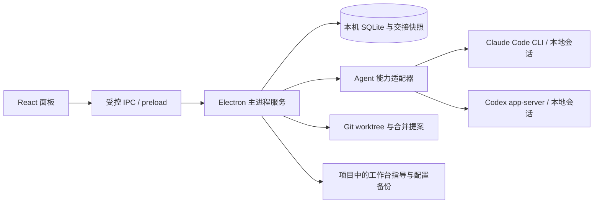

# Agent Workbench

**在一个项目里查看、交接和协调自己的编码 Agent。**

Agent Workbench 是面向个人的 Windows 本地桌面工作台。它把项目、Agent 能力、规则与 skills、记忆指导、可见对话、任务和 Git 工作区放在同一个面板中，让用户决定何时共享配置、何时把任务交给另一个 Agent，以及何时合并并行工作的结果。

项目与 [TeamAI](https://github.com/Tencent/teamai-cli) 都涉及 Agent 的规则和 skills 管理；Agent Workbench 当前聚焦**个人本机、项目范围和运行中的跨 Agent 协作**。首版深入适配 Claude Code 与 Codex。Antigravity、ZCode 和 WorkBuddy 已有适配器骨架及部分手工导出解析能力，实时会话和任务控制仍待逐一验证。

> **当前状态：Windows 0.1.0 候选版。** 已通过离线测试、浏览器界面测试和打包应用启动检查；尚未完成真实付费模型任务、安装升级与卸载的人工验收。Claude Code 与 Codex 的未验证操作会标为降级或未知；另外三个适配器尚未实现真实安装探测。

## 这个项目解决什么问题

个人同时使用多个编码 Agent 时，同一个项目的信息会分散在各自的规则文件、skill 目录和会话中。切换工具经常意味着重新解释背景，多个 Agent 同时改仓库又容易互相覆盖。

Agent Workbench 以**项目**为主要工作范围，提供一条由用户控制的协作链：

1. 登记本地项目，查看 Claude Code、Codex 的实际能力和其他 Agent 的待验证状态。
2. 扫描已有规则和 skills，预览差异后选择是否发布到目标 Agent。
3. 选择记忆来源和用途，将内容发布为工作台管理的项目指导或任务上下文。
4. 从源 Agent 的可见会话建立交接包，检查完整性与敏感提示，编辑交接副本后启动目标 Agent 的新任务。
5. 将写仓库的并行任务放进独立 Git worktree，审查冲突与分支状态，再决定是否应用合并结果。

**不会自动互转记忆或对话。** 配置发布、记忆转移、交接、任务启动与合并都由用户在面板中明确触发。

## 快速开始

### 环境要求

- Windows；开发运行需要 Node.js 22 或更新版本及 npm。
- Git；并行写仓库与合并功能要求所登记的项目本身是 Git 仓库。
- 要使用 Claude Code 或 Codex 的原生会话和任务能力，需分别安装对应 CLI，并按各工具自己的方式完成登录。工作台不接收 API key，也不读取登录令牌。

从源码启动：

```powershell
git clone https://github.com/legend91019/agent-home.git
cd agent-home
npm ci
npm run dev
```

首次打开后，在「项目」页输入本地项目目录并登记，点击项目卡片选中它。随后可在「任务」「对话交接」「共享配置」等页面操作。Antigravity、ZCode、WorkBuddy 当前显示未接入状态；这不代表它们在用户电脑上一定没有安装。

想生成安装包时，执行 `npm run make`。Windows Squirrel 安装程序与 zip 会输出到 `out/make/`；该目录不纳入 Git。当前仓库没有通过 GitHub Release 发布预编译安装包。

### 一次典型的跨 Agent 交接

1. 在 Claude Code 或 Codex 中已有与该项目关联的可读取会话。
2. 在「对话交接」选择源 Agent 和会话，创建交接包。
3. 查看可见消息、工具输入输出、完整性检查和敏感内容提示；必要时编辑或删除交接副本中的消息。
4. 确认审查后，选择目标 Agent，创建新的接续任务。

交接包保留适配器**能够取得的完整可见历史**，包括用户、助手和工具事件；隐藏推理不会读取。完整性取决于适配器支持的消息类型：不可读取的附件会标明缺失，未知事件格式会使交接失败。目标任务收到一个本机 UTF-8 历史文件路径和读取指令。能否完整读取该文件仍受目标 Agent 权限、上下文窗口及实际运行环境影响。

## 功能概览

| 面板 | 当前可以做什么 | 操作边界 |
| --- | --- | --- |
| 项目 | 登记本地目录，选择项目，查看 Claude Code、Codex 的能力探测与其他适配器的接入状态 | 能力按项目和当前工具环境判断，不把“已安装”当作“全部能力可用” |
| 任务 | 创建项目任务，查看 Run 状态；对有原生控制句柄的 Run 发起中断 | 真实启动与中断取决于适配器能力；应用重启后不能控制已丢失的原生句柄 |
| 对话交接 | 读取项目会话，存储来源快照，检查完整性与敏感提示，编辑交接副本，启动目标新任务 | 仅转移可见内容；附件若不可读取会标明缺失，不会静默补全 |
| 共享配置 | 扫描规则、知识文件和 skills；按来源逐项预览、选择并发布 | 当前只验证 Claude Code 与 Codex 的原生发布路径；冲突与来源漂移会阻止覆盖 |
| 记忆互转 | 选择来源 Agent、目标 Agent 与用途，预览后发布指导文件 | 当前来源为项目内 Claude Code 的 `CLAUDE.md`、`.claude/CLAUDE.md`、Codex 的 `AGENTS.md` 及已导入条目；不改写目标 Agent 的原生自动记忆 |
| 工作流 | 编辑顺序或并行节点、依赖、Agent、指令和人工审查门；暂停、恢复、批准、重试 | 写仓库节点使用独立 worktree；需要用户根据状态推进和审查 |
| 合并审查 | 查看分支、基线与冲突，拒绝或应用无冲突提案 | 分支改动须先提交，目标工作区须干净；应用结果暂存但不自动提交或推送 |
| 用量统计 | 已有 token 与 skill 调用证据的聚合逻辑；配置扫描后可显示已发现 skill | 真实运行事件的自动摄入及用户导入入口尚未接入；日常使用时 token 和调用次数通常为未知或无记录 |
| 恢复与诊断 | 检查重启后状态、孤儿工作区和半成品发布 | 检查报告不等于自动修复；强制退出后的配置发布需依据备份人工恢复 |

### Agent 适配状态

| Agent | 已接入的主要能力 | 当前验证范围 |
| --- | --- | --- |
| Claude Code | 本地 JSONL 会话列表与可见历史；通过 CLI 创建托管任务；项目 `CLAUDE.md` 与 `.claude/skills/` 发布 | 会话解析与任务生命周期经过夹具、伪 CLI 测试；未在本项目发起真实付费任务；不声明精确用量或中断能力 |
| Codex | app-server 会话列表与可见历史；新建或恢复任务；托管运行中断；项目 `AGENTS.md` 与 `.agents/skills/` 发布 | 本机只读会话验证及伪服务测试通过；任务启动和中断仍标为降级，未执行真实付费模型调用 |
| Antigravity、ZCode、WorkBuddy | 适配器骨架和部分本地导出 JSON/JSONL 解析函数 | 尚无真实安装探测；面板中的实时会话、原生配置发布和任务控制未验证，不显示为已支持 |

配置扫描会发现项目根目录的 `CLAUDE.md`、`AGENTS.md`、`GEMINI.md`、`.agent-workbench/knowledge.md`，以及项目中包含 `SKILL.md` 的目录。**发现不等于发布或调用。** 若多个来源映射同一目标，发布时只能选一个；`manual-merge` 目前没有交互式合并结果输入，需在外部处理后重新预览。详情见[配置发布安全约定](docs/compatibility/config-publishing.md)。

## 工作方式与数据流



工作台把原生工具视为能力各异的适配器。主进程负责项目登记、状态持久化、交接归档、配置发布和 Git 操作；渲染进程只通过列出的 IPC 通道调用这些服务。能力探测使用 `supported`、`degraded`、`unknown` 和 `unsupported` 表示可用程度与证据，不要求所有 Agent 实现相同接口。

项目级内容与应用级状态分开放置：

| 位置 | 存放内容 |
| --- | --- |
| `%LOCALAPPDATA%/AgentWorkbench` | 默认本机数据目录，包括 SQLite、交接历史文件、内容存储和应用管理的 worktree；可用 `AGENT_WORKBENCH_DATA_DIR` 覆盖 |
| `<项目>/.agent-workbench/memory/` | 用户预览后发布的 `<agent>.md` 项目指导及 `<agent>-task.md` 任务上下文；由工作台启动的任务会收到读取路径 |
| `<项目>/.agent-workbench/backups/` | 配置发布前的目标备份与恢复清单 |
| Agent 原生目录 | Claude Code 与 Codex 各自管理的会话及配置；工作台只在用户选择发布时写入已验证目标 |

交接快照与原生会话之间保留来源关系。删除或编辑交接副本不会改动原生会话。工作台不扫描凭据文件，也不主动把会话历史同步到远端；目标 Agent 读取交接文件后的数据处理遵循该工具自己的服务规则，请在交接审查时清理不应分享的内容。

## 代码仓库结构

```text
agent-home/
├─ src/
│  ├─ main/
│  │  ├─ adapters/       # 五种 Agent 的能力探测、会话读取与任务接口
│  │  ├─ config/         # 规则和 skill 扫描、差异预览、发布与回滚
│  │  ├─ db/             # SQLite 封装与版本化迁移
│  │  ├─ handoff/        # 可见会话归档、交接副本、检索与完整性检查
│  │  ├─ ipc/            # 面板可调用的受控主进程入口
│  │  ├─ memory/         # 记忆条目发现与项目指导发布
│  │  ├─ merge/          # 多分支冲突探测和合并提案
│  │  ├─ projects/       # 本地项目登记
│  │  ├─ recovery/       # 重启后的状态核对与诊断
│  │  ├─ tasks/          # 任务、Run 状态机与事件
│  │  ├─ usage/          # 有来源标记的 token 和 skill 用量聚合
│  │  ├─ workflows/      # 工作流定义和调度
│  │  ├─ workspaces/     # Git worktree 管理
│  │  ├─ electron-main.ts # Electron 窗口与 IPC 边界
│  │  └─ preload.ts     # 隔离的渲染进程桥接
│  ├─ renderer/          # React 面板与调用封装
│  └─ shared/            # 主进程和界面共用的契约、错误类型
├─ tests/
│  ├─ unit/              # 状态机、发布、记忆、用量等单元测试
│  ├─ integration/       # 真实临时 Git 仓库与伪 Agent 协议测试
│  ├─ frontend/          # 浏览器界面测试与打包应用冒烟测试
│  └─ fixtures/          # 会话和配置测试夹具
├─ scripts/              # Claude Code、Codex 的只读探测脚本
├─ docs/
│  ├─ compatibility/     # 适配器和配置发布的验证记录
│  ├─ superpowers/       # 产品设计与开发计划
│  └─ release-checklist.md
├─ forge.config.cjs      # Electron Forge 打包配置
├─ vite.*.config.ts      # 主进程、preload、界面的构建配置
├─ package.json
└─ README.md
```

主要技术栈为 Electron、React、TypeScript、Vite、Node 内置 SQLite、Git worktree、Vitest 与 Playwright。外部 Agent 进程通过参数数组启动，不将用户任务文本拼成 shell 命令。

## 开发与验证

```powershell
npm ci
npm run dev                 # 启动开发版
npm run typecheck           # 核心 TypeScript 检查
npm run typecheck:electron  # Electron 入口检查
npm test                    # 单元与集成测试
npm run e2e                 # 浏览器面板测试：使用模拟 IPC
npm run package             # 生成未安装的 Windows 应用目录
npm run make                # 生成 Squirrel 安装程序与 zip
npm run smoke:package       # 启动打包应用并验证窗口、IPC、SQLite
```

`npm run probe:adapters` 可在已安装对应 CLI 的机器上做 Claude Code、Codex 的只读能力探测。浏览器 E2E 和适配器伪服务测试不会消耗模型额度；它们不能替代真实账户下的任务验收。Electron 二进制下载若因当前网络失败，可在 PowerShell 会话中设置 `ELECTRON_MIRROR` 后重试安装和构建。

本机候选版曾通过 140 项后端测试、7 项浏览器界面测试、类型检查和打包应用冒烟测试。运行环境或依赖更新后请重新执行上述命令；详细记录与未完成的人工验收见[发布检查清单](docs/release-checklist.md)。

## 当前限制与后续方向

- Claude Code、Codex 的真实模型启动、中断、权限交互和交接文件读取仍需在实际账户环境中验收。
- Antigravity、ZCode、WorkBuddy 的实时适配未完成；现有手工导出解析函数不等于面板已经支持自动交接。
- token 与 skill 调用证据的自动摄入和用户导入入口、完整二进制附件、长历史分页与交互式三方冲突解决尚未接入。
- 无冲突合并要求目标与参与分支的工作区干净；工作台不会替用户提交或推送。配置多文件发布在进程被强制结束时保留备份与恢复清单，但尚无自动恢复。
- 已生成 Windows 安装包，但目标机器上的安装、升级和卸载流程仍待人工验证。

后续优先完成真实 Claude Code/Codex 端到端验收，再逐个扩展其他 Agent 的已验证能力，同时补齐用量摄入和冲突处理。设计取舍见[完整设计文档](docs/superpowers/specs/2026-10-25-agent-workbench-design.md)，实施顺序见[开发计划](docs/superpowers/plans/2026-10-25-agent-workbench-development-plan.md)。
